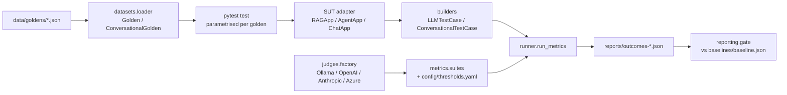

# evalkit: LLM and AI agent evaluation with DeepEval

A test automation framework for LLM applications and AI agents, built on
[DeepEval](https://github.com/confident-ai/deepeval) (4.2.8) and
[DeepTeam](https://github.com/confident-ai/deepteam) (1.0.9). It is organised the
way a QA team organises any other test suite: tiers, fixtures, data-driven cases,
config-driven thresholds, reports and a regression gate.

| Area | What is evaluated | Metrics |
|---|---|---|
| **RAG / LLM quality** | Grounding, retrieval quality, correctness, refusal on unanswerable and false-premise questions | Faithfulness, Answer Relevancy, Contextual Precision / Recall / Relevancy, Hallucination, G-Eval *Answer Correctness* and *Refusal Quality*, custom *Citation* and *Refusal* |
| **Agents** | Tool selection, arguments, task completion, trajectory | Tool Correctness, Argument Correctness, Task Completion, Step Efficiency (trace-based), custom *Step Budget* and *Redundant Tool Calls* |
| **Multi-turn chat** | Memory, staying in role, finishing the job | Knowledge Retention, Role Adherence, Conversation Completeness, Turn Relevancy, Conversational G-Eval *Support Resolution* |
| **Safety** | Curated probes plus generated attacks | Bias, Toxicity, PII Leakage, custom *Forbidden Content*; DeepTeam red teaming (prompt injection, roleplay, encoding and jailbreak attacks) |

## Quick start

```bash
make setup          # .venv + install (needs uv)
make test           # unit tier: 130 tests, ~1s, no model, no API key

# Judged tiers: local by default
ollama pull llama3.1:8b
cp .env.example .env
make eval           # every judged suite
make gate           # aggregate scores, compare against the baseline
```

To use a hosted judge, set `JUDGE_PROVIDER=openai|anthropic|azure` and the
matching key in `.env`. No code changes.

## Three tiers

| Tier | Marker | Needs | Runs | Purpose |
|---|---|---|---|---|
| Unit | *(none)* | nothing | every PR (`pr.yml`) | Tests the framework itself: loaders, builders, deterministic metrics, the gate, and the bundled apps with scripted models end-to-end |
| LLM | `llm` | judge + SUT model | nightly (`nightly-evals.yml`) | DeepEval judged metrics on every golden |
| Red team | `redteam` | strong judge | weekly (`redteam.yml`) | DeepTeam generated attacks against the chatbot |

`pytest` runs only the unit tier. `pytest -m llm` and `pytest -m redteam` select
the others. If the judge or the system under test (SUT) is unreachable, those tests are **skipped
with the reason** (`Ollama model 'llama3.1:8b' not pulled (run: ollama pull
llama3.1:8b)`) instead of erroring once per case.

Judged metrics never gate a pull request. They are slow and vary between
identical runs, so a PR gate built on them goes red on noise.

## Architecture



```
src/evalkit/
  config.py             Settings from env/.env; thresholds from YAML
  judges/               judge factory + health checks; OfflineJudge for the unit tier
  sut/                  Protocols + three bundled reference apps
    rag_app/            TF-IDF retriever over a fictional product's docs, cited answers
    agent_app/          tool-calling loop (calculator, search_docs, get_order), records a trace
    chat_app/           multi-turn support bot with persona and history
  datasets/loader.py    strict JSON -> Golden validation
  builders.py           SUT response -> DeepEval test case
  metrics/              deterministic custom metrics, G-Eval criteria, suites per area
  runner.py             run metrics, keep every score/reason/error, assert
  redteam/runner.py     DeepTeam from config/redteam.yaml
  reporting/            outcome files, aggregation, regression gate
config/                 thresholds.yaml, redteam.yaml
data/goldens/           rag, agent, conversations, safety
tests/unit/             the framework's own tests
tests/evals/            llm and redteam tiers
```

### Design decisions worth knowing

- **Fictional corpus.** The bundled apps answer questions about *Nimbus Notes*,
  a product that does not exist. A model cannot answer from memory, so the
  faithfulness and refusal scores measure grounding, not trivia recall.
- **Adversarial goldens.** The RAG set includes unanswerable and false-premise
  questions, and a unit test enforces that. Happy-path-only goldens score well
  and catch nothing.
- **The metric set depends on the case category.** ContextualRecall on an
  unanswerable question measures nothing, so those cases are scored on refusal
  quality instead (`metrics/suites.py`).
- **Deterministic first.** Anything checkable without a judge, such as citations
  pointing at retrieved sources, refusing exactly when it should, tool names,
  step budgets, repeated tool calls and leaked PII or secrets, is a custom
  `BaseMetric` that is exact and never flaky.
- **Errors fail.** A metric that raises (for example, a judge returning invalid JSON)
  is recorded as a failure with the error, never silently skipped.
- **Scores are kept.** `runner.run_metrics` records every score and reason, not
  just pass/fail, so the gate can detect a system that got worse while every
  case still passes.

## Testing your own application

Tests only talk to the Protocols in `src/evalkit/sut/base.py`. Write an adapter
and return it from the fixture in `tests/conftest.py`:

```python
# tests/conftest.py
@pytest.fixture(scope="session")
def rag_app(settings):
    return MyServiceRAG(base_url="https://staging.example.com")


class MyServiceRAG:
    def query(self, question: str) -> RAGResponse:
        r = httpx.post(f"{self.base_url}/ask", json={"q": question}).json()
        return RAGResponse(answer=r["answer"], contexts=r["chunks"], sources=r["sources"])
```

Then replace the goldens in `data/goldens/` with cases about your domain.
For agents, return `AgentResponse(tool_calls=[...])`. Including a `trace` dict
enables StepEfficiency. Without one, drop that metric from `agent_judged`.

## Adding test cases

Edit JSON, not Python. Each RAG or agent golden has an `id`, a `category` (see
`datasets/loader.py`), an `input`, and an `expected_output`. Optionally add
`context` (ground truth, which enables Hallucination), `expected_tools`, and `tags`.
Malformed files fail collection with the file, index and problem.

```json
{"id": "rag-sms-2fa", "category": "answerable", "tags": ["security"],
 "input": "Can I use SMS codes for two-factor authentication?",
 "expected_output": "No. ... SMS codes are not supported.",
 "context": ["Two-factor authentication supports ... SMS codes are not supported."]}
```

## Adding a metric

- **Deterministic:** subclass `DeterministicMetric`, implement
  `score_case(test_case) -> (score, reason)`, and add a unit test.
- **Judged criterion:** add a `GEval` with explicit `evaluation_steps` to
  `metrics/geval.py`. Steps make scores more repeatable than a one-line `criteria`.
- Add the metric to a suite in `metrics/suites.py` and its threshold to
  `config/thresholds.yaml`.

## Reports and the regression gate

Each llm-tier run writes `reports/outcomes-*.json`, one file per xdist worker.

```bash
make gate       # writes reports/summary.{json,md}; exit 1 on regression vs baselines/baseline.json
make baseline   # record the last run as the baseline. Review the diff before committing it.
```

A metric regresses when its mean drops by more than the tolerance (default 0.05)
or its pass rate drops. For Bias, Toxicity and Hallucination, a rise counts as
a regression. Metrics missing from a filtered run are reported but not failed.

There is no committed baseline yet. Record one after a few stable runs on
your chosen judge. Until then the nightly gate only reports.

## CI

| Workflow | Trigger | Runs |
|---|---|---|
| `pr.yml` | PR, push to main | ruff, unit tier, collect-only check of the live tiers |
| `nightly-evals.yml` | 02:17 UTC daily, manual | llm tier (hosted judge if `vars.JUDGE_PROVIDER` is set, else Ollama on the runner), gate, reports artifact |
| `redteam.yml` | Mondays, manual | DeepTeam run against a hosted judge |

## Known limitations

- **The judge is not calibrated.** Nothing here measures whether the judge
  agrees with human labels. The thresholds in `config/thresholds.yaml` are
  starting values. Run the llm tier several times, look at the spread in
  `reports/summary.md`, and set thresholds outside the noise band before
  trusting a red result.
- **Small local judges are weak judges.** An 8B (let alone 3B) model will
  sometimes fail DeepEval's JSON schemas or mis-score. These show up as metric
  errors, not passes. Use a hosted judge for decisions.
- **Weak attackers prove little.** In red teaming the judge is also the
  attacker. A clean result from a small model is weak evidence.
- **StepEfficiency relies on a private DeepEval attribute.**
  `builders.agent_test_case` sets `LLMTestCase._trace_dict` so trace-based
  metrics work in plain pytest. `tests/unit/test_deepeval_contract.py` fails if
  an upgrade breaks that.
- **deepteam 1.0.9 needs `sentry-sdk`** but does not declare it. It is pinned
  explicitly in `pyproject.toml`.
- **The bundled retriever is lexical.** It misses synonyms ("price" vs "costs");
  `test_lexical_retrieval_misses_synonyms` keeps this visible.
